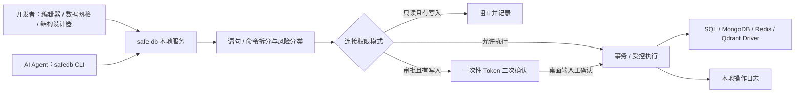

# safe db — 面向 AI Agent 的安全数据库工具

[简体中文](README.md) | [English](README_EN.md)

> 让 Codex、Claude Code 和其他 AI Agent 看懂数据库、执行 SQL，同时把权限、审批和审计留在你手里。

> [!IMPORTANT]
> **safe db 永久免费。现在免费，未来也免费；所有功能均可免费使用，不按连接数、查询次数或 Agent 数量收费。**

AI Agent 已经能够阅读代码、修改项目、运行测试，但当它需要访问数据库时，开发者往往只能在两种不理想的方案中选择：把连接信息直接交给 Agent，或者自己充当它和数据库之间的“人工 API”。

safe db 提供第三种方式：它既是开发者熟悉的桌面数据库工作台，也是专门为 AI Agent 设计的本地数据库网关。Agent 可以通过结构化 CLI 发现连接、读取 Schema、检查并执行 SQL，但不会获得数据库密码；所有操作继续经过 safe db 的权限、审批和审计链路。

你可以在同一个工具里：

- 自己浏览数据库、编辑数据和设计表结构。
- 让 Agent 自动理解一张或多张表，并返回稳定 JSON。
- 用只读模式直接阻止写入，用审批模式把最终决定交给人。
- 在本地保存连接与审计记录，不把数据库资产上传到第三方服务。

## Navicat / TablePlus 的免费替代选择

如果你的日常工作主要是连接数据库、浏览对象、编辑 SQL、管理表数据和修改表结构，safe db 可以作为 Navicat、TablePlus 等传统数据库管理工具的免费替代选择。

但 safe db 不只是复制传统数据库客户端。它面向 AI Agent 时代重新设计了数据库访问方式：既能承担开发者常用的数据库管理工作，也能让 Codex、Claude Code 等 Agent 在不接触密码的情况下读取数据库结构、检查并执行 SQL，同时把高风险操作交给人确认。

相比“拥有所有传统客户端功能”，safe db 当前更专注于三件事：

- **开发者日常够用**：连接管理、对象浏览、SQL 编辑、表数据管理、结构设计和结果导出。
- **Agent 可以直接使用**：稳定 JSON CLI、单表与多表结构上下文、SQL 执行和审批等待。
- **生产操作有边界**：只读、审批、完全访问三档权限，加上本地审计记录。

如果你依赖复杂的数据迁移、完整备份恢复、ER 图建模或大量数据库类型支持，仍可保留现有专业工具；safe db 希望先成为开发者和 AI Agent 最自然、最安全的日常数据库入口。

## 让 Agent 在几条命令内理解数据库

```bash
# Agent 先发现有哪些连接
safedb connection list

# 再发现数据库与对象
safedb database list --connection <连接ID>
safedb object list --connection <连接ID> --database <数据库>

# 一次读取单张或多张表结构
safedb table describe --connection <连接ID> --database <数据库> \
  --table users --table orders

# SQL 从文件或标准输入进入，不出现在进程参数中
safedb sql run --connection <连接ID> --database <数据库> --stdin < query.sql
```

CLI 默认输出稳定的单行 JSON，Codex、Claude Code 以及其他支持 Shell 的 Agent 都可以直接调用。人工在终端查看时可使用 `--human` 获得表格与摘要，或使用 `--format pretty` 查看缩进 JSON。Agent 只引用 safe db 中已有的连接，数据库与 SSH 凭据不会通过 CLI 暴露。

## 为什么是 safe db？

常见数据库客户端只解决“人如何操作数据库”；safe db 同时解决“人和 AI Agent 如何安全地共享数据库能力”。

- **为 Agent 而生的 CLI**：连接、数据库、对象和表结构均为机器可读 JSON，支持单表和多表上下文。
- **凭据不交给 Agent**：CLI 只使用已经保存在 safe db 中的连接，不返回数据库或 SSH 密码。
- **同一条安全链路**：桌面端和 Agent CLI 共用 SQL 分类、权限判定、审批、执行与审计能力。
- **默认更克制**：新连接默认只读，无法可靠识别的语句按高风险处理。
- **人保留最终决定**：审批模式下，Agent 提交写操作后必须在桌面端由人确认。
- **开发者体验完整**：对象浏览、SQL 补全、数据编辑、结构设计、结果导出、查询保存和多窗口都已具备。
- **本地优先**：连接、保存的查询和操作日志都留在本机，不依赖云端数据库代理。

## 核心能力

### 功能一览

| 功能模块 | 主要能力 |
| --- | --- |
| AI Agent CLI | 连接发现、数据库与对象浏览、单/多表结构、DDL、SQL 检查与执行、审批等待 |
| 机器可读协议 | 稳定 JSON 输出、本地 Socket 通信、明确的状态与错误码 |
| 数据库连接 | MySQL、PostgreSQL、SQLite、SQL Server、MongoDB、Redis、Qdrant，支持连接测试 |
| SSH 隧道 | 所有 TCP 数据库连接均可使用跳板机，支持密码与私钥认证 |
| 对象浏览 | 浏览数据库、Schema、表、视图、函数和存储过程 |
| SQL 编辑 | 方言感知补全、快捷执行、多标签页与查询保存 |
| 数据管理 | 分页、排序、组合筛选及行新增、修改、删除 |
| 结构设计 | 查看列、索引与 DDL，可视化建表和结构修改 |
| 安全控制 | 只读、审批、完全访问三档权限及高风险 SQL 拦截 |
| 操作日志 | 记录成功、失败、被阻止和被取消的数据库操作 |
| 数据导出 | 查询结果和表数据导出为 CSV / JSON；连接级导出数据、结构或结构和数据 |
| 多语言 | 支持多语言界面，可按使用习惯切换语言 |
| 工作台体验 | 多窗口和可调节面板 |

### 支持的操作系统

safe db 基于 Electron 和 Node.js，桌面端与 Agent CLI 支持主流桌面操作系统：

| 操作系统 | 支持状态 | 说明 |
| --- | --- | --- |
| macOS | ✅ 支持 | Apple Silicon 与 Intel；凭据使用系统钥匙串保护 |
| Windows | ✅ 支持 | Windows 10 / 11；本地 Agent 服务使用 Named Pipe |
| Linux | ✅ 支持 | 推荐 Ubuntu、Debian、Fedora 等桌面发行版；保存凭据需要可用的系统密钥环 / Secret Service |

当前仓库提供源码运行与构建方式。不同系统安装原生依赖后，需要执行 `npm run rebuild` 为当前 Electron 版本重建 SQLite 模块。

### 支持的数据库

| 数据库 | 对象与结构浏览 | 查询执行 | SSH 隧道 | Agent CLI |
| --- | --- | --- | --- | --- |
| MySQL | ✅ | ✅ | ✅ | ✅ |
| PostgreSQL | ✅ | ✅ | ✅ | ✅ |
| SQLite | ✅ | ✅ | 不需要 | ✅ |
| SQL Server | ✅ | ✅ SQL | ✅ | ✅ |
| MongoDB | ✅ Collection / 样本 Schema | ✅ JSON 原生命令 | ✅ | ✅ |
| Redis | ✅ Key / 数据类型 | ✅ Redis CLI 命令 | ✅ | ✅ |
| Qdrant | ✅ Collection / Point / Payload Index | ✅ 受限 REST JSON | ✅ | ✅ |

### 三档连接权限

| 模式 | 读取操作 | 写入 / DDL | 适合场景 |
| --- | --- | --- | --- |
| 只读 | 直接执行 | 直接阻止 | 生产排查、数据核对、演示环境 |
| 审批 | 直接执行 | 弹窗确认后执行 | 日常运维、谨慎的数据修正 |
| 完全访问 | 直接执行 | 直接执行 | 本地开发库、测试库 |

权限模式还可以锁定，避免在使用连接时被随手切换。多语句 SQL 或多条原生命令会按其中风险最高的操作处理；无法可靠识别的操作默认按写入收紧权限。

### 开发者和 Agent 共用的数据库工作台

- MySQL、PostgreSQL、SQLite、SQL Server、MongoDB、Redis、Qdrant 连接与连接测试
- 所有 TCP 数据库连接均支持 SSH 跳板机、密码与私钥认证
- 数据库、Schema、表、视图、函数和存储过程浏览
- MySQL、PostgreSQL、SQL Server 和 MongoDB 支持右键删除数据库，需输入数据库名称确认，并沿用连接的只读限制、审批和审计；系统库受保护。
- CodeMirror SQL 编辑器、方言感知补全与 `Cmd/Ctrl + Enter` 快速执行
- 查询保存、连接级 / 数据库级归档和包含加密凭据的完整连接导入导出
- 表数据分页、排序、组合筛选、行新增 / 修改 / 删除
- 无主键表自动降级为只读浏览，避免无法准确定位行
- 表结构、列、索引、DDL 与函数定义查看；支持可视化建表和结构修改
- 查询结果或表数据导出为 CSV / JSON
- 右键左侧连接，选择“导出数据”“导出结构”或“导出结构和数据”，可多选数据库并保存为 JSON 文件；记录按页读取，不受单表 5 万行导出上限限制。结构包含对象定义、字段、索引、约束和方法定义，视图仅导出定义。二进制、大整数与日期使用带 `$safeDbType` 的 JSON 对象保存，MongoDB 使用规范 Extended JSON，Qdrant 包含完整向量。导出按读取时的实时数据生成，不提供跨表事务快照。
- 多语言界面、多标签页、多窗口和可调节面板

### MongoDB、Redis 与 Qdrant 原生命令

MongoDB 查询编辑器接受单个 JSON 数据库命令，或由命令对象组成的 JSON 数组：

```json
{"find":"users","filter":{"active":true},"limit":100}
```

Redis 查询编辑器使用 Redis CLI 语法，每行一条命令，支持引号参数：

```text
GET "user:1"
HGETALL "profile:1"
```

MongoDB Collection 与 Redis Key 可在左侧对象树中浏览，并直接在数据网格中新增、修改、删除和批量导入。MongoDB 还支持 Collection 创建、复制、清空、删除和索引管理；Redis 支持各数据类型的 Key 创建、复制与删除，其中 Stream 记录只开放新增和删除。Redis 无法保留一个没有任何数据的 Key，因此能力模型不会把“清空但保留 Key”伪装成可用功能。原生命令编辑器继续作为高级入口，并同样经过只读 / 审批 / 完全访问权限管道。

Qdrant 查询编辑器接受受限 REST JSON，只允许访问当前连接内经过安全分类的 API 路径。例如执行向量查询：

```json
{
  "method": "POST",
  "path": "/collections/documents/points/query",
  "body": { "query": [0.1, 0.2], "limit": 10, "with_payload": true }
}
```

Qdrant Collection 直接显示在连接下；Point 使用游标分页浏览，向量默认不加载。数据页支持新增、编辑和批量删除 Point，Collection 菜单支持 JSON/CSV 导入、清空、删除、定义查看以及 Payload Index 管理。REST JSON 可使用受限的 `query` 对象传递 `wait`、`ordering`、`timeout` 和 `consistency`。

全部七类数据库驱动都使用统一的能力模型和结构化操作协议：渲染进程只提交操作意图，标识符转义、参数绑定、MongoDB BSON、Redis 命令与 Qdrant REST 构造均在主进程驱动完成。MySQL、PostgreSQL、SQLite 与 SQL Server 支持参数化 CRUD、表创建/变更/复制/清空/删除和索引管理；MongoDB、Redis、Qdrant 则按各自领域对象公开真实能力。每次执行都会返回实际的 `transaction`、`single-request` 或 `best-effort` 原子性，不承诺不存在的跨请求回滚。

### 安全执行链路

无论 SQL 或原生命令来自开发者还是 AI Agent，都会经过同一条执行管道：



分类器会跳过注释、字符串和引用标识符，识别数据修改 CTE、`EXPLAIN ANALYZE`、`SELECT INTO` 与多语句 SQL 等容易误判的情况。写入与 DDL 多语句会放入事务中执行。

## 快速开始

建议使用 Node.js 20 LTS 和 npm 10+。

```bash
git clone <your-repository-url>
cd safe-db
npm ci
npm run rebuild
npm run dev
```

如需在本机测试各数据库驱动，可通过 Docker Compose 一次启动除 SQLite 外的全部数据库：

```bash
npm run db:up
docker compose ps
```

所有宿主机端口均使用 `60000` 段，连接地址统一为 `127.0.0.1`：

| 数据库 | 端口 | 用户名 | 密码 | 默认数据库 / 认证库 |
| --- | ---: | --- | --- | --- |
| MySQL | 60001 | root | `SafeDb_123456` | safedb |
| PostgreSQL | 60002 | postgres | `SafeDb_123456` | safedb |
| SQL Server | 60003 | sa | `SafeDb_123456` | master |
| MongoDB | 60004 | root | `SafeDb_123456` | admin / admin |
| Redis | 60005 | default | `SafeDb_123456` | 0 |
| Qdrant | 60006 | - | - | - |

也可以只启动单个服务，例如 `docker compose up -d postgres`。停止服务使用 `npm run db:down`；如需同时清除测试数据卷，使用 `docker compose down -v`。SQLite 无需容器，可直接在新建连接时选择目录并创建数据库文件。

`npm run rebuild` 会为当前 Electron 版本重建 `better-sqlite3` 原生模块。首次启动后：

在 macOS 开发模式下，`npm run dev` 会在 `node_modules/.cache/` 中自动准备名称为 `safe db` 的 Electron 运行时，使系统菜单栏也显示正确的产品名；该缓存不会进入版本控制。

1. 点击左侧“新建”，选择 MySQL、PostgreSQL、SQLite、SQL Server、MongoDB、Redis 或 Qdrant。
2. 填写连接信息，并选择权限模式；连接生产库时建议从“只读”开始。
3. 测试并保存连接，双击连接浏览对象。
4. 双击表查看数据，或右键连接创建 SQL 查询。
5. 需要写入时，切换到“审批”模式即可保留二次确认保护。

希望让 Agent 使用数据库时，再执行一次生产构建：

```bash
npm run build
node scripts/safedb.mjs connection list
```

安装为 npm bin 后，可以直接使用 `safedb` 命令。

## 常用命令

```bash
# 启动开发环境（主进程、preload、渲染进程热更新）
npm run dev

# TypeScript + Vue 类型检查
npm run typecheck

# SQL 风险分类器测试
npm run test:classify
npm run test:native
npm run test:qdrant
npm run test:operations
npm run test:export
npm run test:drop-database
npm run test:drivers

# AI Agent CLI 服务测试
npm run test:agent

# AI Agent CLI 输出与多语言帮助测试
npm run test:cli

# 生成生产构建到 out/
npm run build

# 预览生产构建
npm run start
```

## AI Agent CLI 参考

`safedb` 为 Codex、Claude Code 等可调用 Shell 的 Agent 提供机器可读的数据库入口。CLI 只使用 safe db 已保存的连接，不暴露数据库或 SSH 凭据；所有 SQL 仍经过现有的分类、权限、审批、事务和审计链路。

使用 `safedb --help` 查看全部命令，使用 `safedb <命令> --help` 查看子命令参数。

在源码仓库中先执行一次 `npm run build`，随后可通过 `node scripts/safedb.mjs` 调用；安装为 npm bin 后可直接使用 `safedb`：

```bash
# 发现连接与数据库对象
safedb connection list
safedb database list --connection <连接ID或精确名称>
safedb object list --connection <连接ID> --database <数据库>

# 单表或多表结构；--table 可以重复，单次最多 20 个不同表
safedb table describe --connection <连接ID> --database <数据库> --schema <Schema> \
  --table users --table orders

# SQL 只从标准输入或文件读取，避免进入进程参数和 Shell 历史
safedb sql check --connection <连接ID> --database <数据库> --file query.sql
safedb sql run --connection <连接ID> --database <数据库> --stdin < query.sql

# 审批模式的写操作返回 requestId，由桌面端人工处理
safedb request get <requestId>
safedb request wait <requestId> --timeout 60

# 人类可读表格/摘要，以及缩进 JSON
safedb connection list --human
safedb table describe --connection <连接ID> --table users --format human
safedb connection list --format pretty

# 指定帮助语言；也可通过 SAFE_DB_LANG 设置
safedb --help --lang en-US
SAFE_DB_LANG=ja-JP safedb table describe --help
```

CLI 默认的 `--format json` 始终输出单个 JSON 对象，保持 Agent 与脚本兼容。`--format pretty` 输出完整的缩进 JSON；`--format human`（简写为 `--human`）根据命令输出表格、查询结果、DDL 或审批摘要。人类模式的错误写入标准错误，其他结果写入标准输出；各模式的进程退出码保持一致。只读连接会拒绝写入；审批连接会打开桌面审批窗口；完全访问连接沿用连接自身权限直接执行。后台服务未运行时，CLI 会尝试以无窗口模式启动已构建的 safe db。

CLI 帮助支持 `zh-CN`、`zh-TW`、`en-US`、`ja-JP`、`ko-KR`、`de-DE`、`fr-FR`、`es-ES`、`pt-BR` 和 `ru-RU`。语言选择顺序为 `--lang`、`SAFE_DB_LANG`、系统 Locale；无法匹配时回退到简体中文。`--lang` 仅影响 `help` 和 `--help` 文本，不改变 JSON 协议字段。

仓库的 `scripts/` 目录还包含覆盖 UI、数据库驱动、原生命令分类、权限审批、只读绕过和结构设计器的验证脚本。其中部分脚本需要本地数据库测试实例，并通过开发模式下的 Electron CDP 端口运行。

提交代码前建议至少执行：

```bash
npm run typecheck
npm run test:classify
npm run test:native
npm run test:qdrant
npm run test:operations
npm run test:export
npm run test:drop-database
npm run test:agent
npm run test:cli
npm run build
```

## 技术栈

| 层 | 技术 |
| --- | --- |
| 桌面运行时 | Electron 33、electron-vite |
| 前端 | Vue 3、TypeScript、Pinia、Vue Router |
| UI / 编辑器 | Naive UI、CodeMirror 6 |
| 数据库 | mysql2、pg、better-sqlite3、mssql、mongodb、redis、@qdrant/js-client-rest |
| 网络 | ssh2 |
| 本地存储 | JSON、SQLite、Electron safeStorage |

## 项目结构

```text
safe-db/
├── src/
│   ├── main/
│   │   ├── agent/        # Agent CLI 本地协议、服务与审批请求生命周期
│   │   ├── core/         # SQL 拆分、风险分类、权限决策、统一执行器
│   │   ├── drivers/      # SQL Server / MySQL / PostgreSQL / SQLite / MongoDB / Redis / Qdrant 驱动
│   │   ├── ssh/          # SSH 隧道生命周期
│   │   ├── store/        # 连接、保存查询与操作日志
│   │   └── ipc.ts        # 主进程 IPC 入口
│   ├── preload/          # 安全暴露给渲染进程的 API
│   ├── renderer/         # Vue 工作台与组件
│   └── shared/           # 主进程 / 渲染进程共享类型契约
├── scripts/              # 分类器测试与端到端验证脚本
└── electron.vite.config.ts
```

## 数据与安全说明

- 连接配置位于 Electron 的 `userData/connections.json`。
- 数据库密码、SSH 密码和私钥口令通过 Electron `safeStorage` 加密；系统安全存储不可用时不会降级为明文保存。
- 保存的查询位于 `userData/queries.json`，操作日志位于 `userData/audit.db`。
- 导出文件包含全部连接信息和保存的查询，数据库密码与 SSH 凭据保持为 `safeStorage` 密文。该密文与系统账户绑定，只有能够解密它的同一系统账户才能在导入后直接使用密码。
- Renderer 启用了 `contextIsolation` 并关闭 `nodeIntegration`，仅通过类型化 preload API 访问主进程能力。
- 数据网格筛选值使用参数绑定，列名和表名按各数据库方言引用。

> [!IMPORTANT]
> safe db 的权限模式是客户端侧防误操作机制，不是数据库自身权限系统的替代品。生产环境仍应使用最小权限账号、数据库审计、备份与变更审批流程。任何客户端规则也无法约束从其他工具或连接发起的操作。

## 参与开发

这个项目很适合从清晰、独立的能力点开始贡献：

- **新增数据库驱动**：实现 `src/main/drivers/base.ts` 中的 `DbDriver` 接口，并在驱动管理器中注册。
- **加固 SQL 分类器**：在 `src/main/core/sqlClassify.ts` 增加规则，同时为对抗性输入补充测试。
- **扩展 Agent 协议**：完善机器可读的对象上下文、结果限制、错误码或新的 Agent 工具能力。
- **完善数据库方言**：改进表结构 DDL、类型映射、函数定义或 SQL 补全。
- **提升工作台体验**：优化数据网格、快捷键、可访问性、主题与大数据量场景。
- **补充语言**：在 `src/renderer/src/locales/` 中扩展翻译，并保持 key 对齐。

提交改动时，请尽量让所有数据库操作继续经过统一 `Executor`，并为涉及权限边界的改动附上失败用例。安全工具最重要的特性不是“看起来能拦截”，而是规则可读、行为可测、失败时能够收紧。

---

如果你正在用 Codex、Claude Code 或自己的 Agent 开发项目，欢迎让 safe db 成为它访问数据库时的安全入口。项目永久免费，也欢迎反馈、贡献和一起把 AI Agent 的数据库体验做得更可靠。
