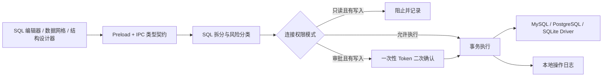

# safe db

[简体中文](README.md) | [English](README_EN.md)

> 一个把“数据库客户端的效率”和“生产操作的安全边界”放在一起设计的桌面数据库工具。

**safe db 完全免费，所有功能均可免费使用。**

safe db 面向需要频繁查看、排查和维护数据库的开发者。它提供熟悉的数据库浏览、SQL 编辑、数据网格与表结构设计体验，同时让每个连接都可以选择 **只读、审批、完全访问** 三种权限模式。

连接生产库时，不必再靠“我会小心”保护数据：写操作可以被直接拦截，也可以在真正执行前要求二次确认，并留下可检索的本地操作记录。

## 为什么是 safe db？

常见数据库客户端通常只关心“能不能执行”，safe db 还关心“这条 SQL 是否应该现在执行”。

- **默认更克制**：新连接默认使用只读模式，未知语句按高风险处理。
- **风险可见**：SQL 在执行前被分类为读取、写入、DDL 或其他操作。
- **防止手滑**：审批模式会拦下 `INSERT`、`UPDATE`、`DELETE` 与 DDL，确认后才执行。
- **操作可追溯**：成功、失败、被阻止和被取消的操作都会进入本地操作日志。
- **日常工作够顺手**：支持对象浏览、SQL 补全、数据编辑、结构设计、结果导出、保存查询与多窗口。
- **本地优先**：连接配置、保存的查询和操作日志都保存在本机，不依赖云端服务。

## 核心能力

### 功能一览

| 功能模块 | 主要能力 |
| --- | --- |
| 数据库连接 | MySQL、PostgreSQL、SQLite，支持连接测试 |
| SSH 隧道 | MySQL / PostgreSQL 跳板机，支持密码与私钥认证 |
| 对象浏览 | 浏览数据库、Schema、表、视图、函数和存储过程 |
| SQL 编辑 | 方言感知补全、快捷执行、多标签页与查询保存 |
| 数据管理 | 分页、排序、组合筛选及行新增、修改、删除 |
| 结构设计 | 查看列、索引与 DDL，可视化建表和结构修改 |
| 安全控制 | 只读、审批、完全访问三档权限及高风险 SQL 拦截 |
| 操作日志 | 记录成功、失败、被阻止和被取消的数据库操作 |
| 数据导出 | 查询结果和表数据导出为 CSV / JSON |
| 多语言 | 支持多语言界面，可按使用习惯切换语言 |
| 工作台体验 | 多窗口和可调节面板 |

### 三档连接权限

| 模式 | 读取操作 | 写入 / DDL | 适合场景 |
| --- | --- | --- | --- |
| 只读 | 直接执行 | 直接阻止 | 生产排查、数据核对、演示环境 |
| 审批 | 直接执行 | 弹窗确认后执行 | 日常运维、谨慎的数据修正 |
| 完全访问 | 直接执行 | 直接执行 | 本地开发库、测试库 |

权限模式还可以锁定，避免在使用连接时被随手切换。多语句 SQL 会按其中风险最高的语句处理；无法可靠识别的语句默认按写操作收紧权限。

### 开发者需要的数据库工作台

- MySQL、PostgreSQL、SQLite 连接与连接测试
- MySQL / PostgreSQL SSH 跳板机，支持密码与私钥认证
- 数据库、Schema、表、视图、函数和存储过程浏览
- CodeMirror SQL 编辑器、方言感知补全与 `Cmd/Ctrl + Enter` 快速执行
- 查询保存、连接级 / 数据库级归档和包含加密凭据的完整连接导入导出
- 表数据分页、排序、组合筛选、行新增 / 修改 / 删除
- 无主键表自动降级为只读浏览，避免无法准确定位行
- 表结构、列、索引、DDL 与函数定义查看；支持可视化建表和结构修改
- 查询结果或表数据导出为 CSV / JSON
- 多语言界面、多标签页、多窗口和可调节面板

### 安全执行链路

所有来自 SQL 编辑器、数据网格和结构设计器的变更都经过同一条执行管道：



分类器会跳过注释、字符串和引用标识符，识别数据修改 CTE、`EXPLAIN ANALYZE`、`SELECT INTO` 与多语句 SQL 等容易误判的情况。写入与 DDL 多语句会放入事务中执行。

## 快速开始

建议使用 Node.js 20 LTS 和 npm 10+。

```bash
git clone <your-repository-url>
cd safe-db
npm ci
npm run rebuild
npm run dev
```

`npm run rebuild` 会为当前 Electron 版本重建 `better-sqlite3` 原生模块。首次启动后：

在 macOS 开发模式下，`npm run dev` 会在 `node_modules/.cache/` 中自动准备名称为 `safe db` 的 Electron 运行时，使系统菜单栏也显示正确的产品名；该缓存不会进入版本控制。

1. 点击左侧“新建”，选择 MySQL、PostgreSQL 或 SQLite。
2. 填写连接信息，并选择权限模式；连接生产库时建议从“只读”开始。
3. 测试并保存连接，双击连接浏览对象。
4. 双击表查看数据，或右键连接创建 SQL 查询。
5. 需要写入时，切换到“审批”模式即可保留二次确认保护。

## 常用命令

```bash
# 启动开发环境（主进程、preload、渲染进程热更新）
npm run dev

# TypeScript + Vue 类型检查
npm run typecheck

# SQL 风险分类器测试
npm run test:classify

# 生成生产构建到 out/
npm run build

# 预览生产构建
npm run start
```

仓库的 `scripts/` 目录还包含覆盖 UI、三种数据库驱动、权限审批、只读绕过和结构设计器的端到端脚本。其中部分脚本需要本地 MySQL / PostgreSQL 测试实例，并通过开发模式下的 Electron CDP 端口运行。

提交代码前建议至少执行：

```bash
npm run typecheck
npm run test:classify
npm run build
```

## 技术栈

| 层 | 技术 |
| --- | --- |
| 桌面运行时 | Electron 33、electron-vite |
| 前端 | Vue 3、TypeScript、Pinia、Vue Router |
| UI / 编辑器 | Naive UI、CodeMirror 6 |
| 数据库 | mysql2、pg、better-sqlite3 |
| 网络 | ssh2 |
| 本地存储 | JSON、SQLite、Electron safeStorage |

## 项目结构

```text
safe-db/
├── src/
│   ├── main/
│   │   ├── core/         # SQL 拆分、风险分类、权限决策、统一执行器
│   │   ├── drivers/      # MySQL / PostgreSQL / SQLite 驱动
│   │   ├── ssh/          # SSH 隧道生命周期
│   │   ├── store/        # 连接、保存查询与操作日志
│   │   └── ipc.ts        # 主进程 IPC 入口
│   ├── preload/          # 安全暴露给渲染进程的 API
│   ├── renderer/         # Vue 工作台与组件
│   └── shared/           # 主进程 / 渲染进程共享类型契约
├── scripts/              # 分类器测试与端到端验证脚本
└── electron.vite.config.ts
```

## 数据与安全说明

- 连接配置位于 Electron 的 `userData/connections.json`。
- 数据库密码、SSH 密码和私钥口令通过 Electron `safeStorage` 加密；系统安全存储不可用时不会降级为明文保存。
- 保存的查询位于 `userData/queries.json`，操作日志位于 `userData/audit.db`。
- 导出文件包含全部连接信息和保存的查询，数据库密码与 SSH 凭据保持为 `safeStorage` 密文。该密文与系统账户绑定，只有能够解密它的同一系统账户才能在导入后直接使用密码。
- Renderer 启用了 `contextIsolation` 并关闭 `nodeIntegration`，仅通过类型化 preload API 访问主进程能力。
- 数据网格筛选值使用参数绑定，列名和表名按各数据库方言引用。

> [!IMPORTANT]
> safe db 的权限模式是客户端侧防误操作机制，不是数据库自身权限系统的替代品。生产环境仍应使用最小权限账号、数据库审计、备份与变更审批流程。任何客户端规则也无法约束从其他工具或连接发起的操作。

## 参与开发

这个项目很适合从清晰、独立的能力点开始贡献：

- **新增数据库驱动**：实现 `src/main/drivers/base.ts` 中的 `DbDriver` 接口，并在驱动管理器中注册。
- **加固 SQL 分类器**：在 `src/main/core/sqlClassify.ts` 增加规则，同时为对抗性输入补充测试。
- **完善数据库方言**：改进表结构 DDL、类型映射、函数定义或 SQL 补全。
- **提升工作台体验**：优化数据网格、快捷键、可访问性、主题与大数据量场景。
- **补充语言**：在 `src/renderer/src/locales/` 中扩展翻译，并保持 key 对齐。

提交改动时，请尽量让所有数据库操作继续经过统一 `Executor`，并为涉及权限边界的改动附上失败用例。安全工具最重要的特性不是“看起来能拦截”，而是规则可读、行为可测、失败时能够收紧。

---

如果你也希望数据库客户端在“高效”之外多一道可靠的安全边界，欢迎试用、反馈并参与改进 safe db。
