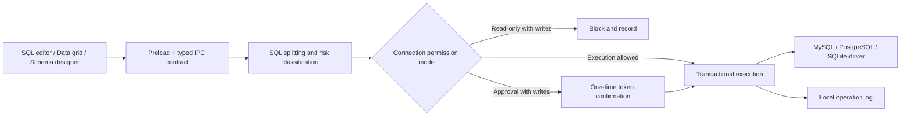

# safe db

[简体中文](README.md) | [English](README_EN.md)

> A desktop database tool designed to combine the efficiency of a database client with safeguards for production operations.

**safe db is completely free, and all features are available at no cost.**

safe db is built for developers who frequently inspect, troubleshoot, and maintain databases. It provides a familiar experience for browsing databases, editing SQL, working with data grids, and designing table structures, while allowing every connection to use one of three permission modes: **Read-only, Approval, or Full access**.

When connecting to a production database, you no longer have to rely on “I’ll be careful” to protect your data. Write operations can be blocked outright or require confirmation before execution, with searchable operation records stored locally.

## Why safe db?

Most database clients only ask whether a statement can be executed. safe db also asks whether it should be executed right now.

- **Safer by default**: New connections use read-only mode by default, and unknown statements are treated as high risk.
- **Visible risk**: SQL statements are classified as read, write, DDL, or other operations before execution.
- **Protection against mistakes**: Approval mode intercepts `INSERT`, `UPDATE`, `DELETE`, and DDL statements until they are confirmed.
- **Traceable operations**: Successful, failed, blocked, and cancelled operations are all written to a local operation log.
- **A practical daily workspace**: Includes object browsing, SQL completion, data editing, schema design, result export, saved queries, and multiple windows.
- **Local first**: Connection settings, saved queries, and operation logs remain on your device without relying on a cloud service.

## Core features

### Feature overview

| Feature | Capabilities |
| --- | --- |
| Database connections | MySQL, PostgreSQL, and SQLite connections with connection testing |
| SSH tunnels | MySQL / PostgreSQL jump hosts with password and private-key authentication |
| Object browser | Browse databases, schemas, tables, views, functions, and stored procedures |
| SQL editor | Dialect-aware completion, keyboard execution, multiple tabs, and saved queries |
| Data management | Pagination, sorting, combined filters, and row insertion, editing, and deletion |
| Schema design | Inspect columns, indexes, and DDL; visually create and alter tables |
| Safety controls | Read-only, Approval, and Full access modes with high-risk SQL interception |
| Operation logs | Record successful, failed, blocked, and cancelled database operations |
| Data export | Export query results and table data as CSV / JSON |
| Multiple languages | Switch the interface language to match your preferences |
| Workspace experience | Multiple windows and resizable panels |

### Three connection permission modes

| Mode | Read operations | Write / DDL operations | Best for |
| --- | --- | --- | --- |
| Read-only | Execute directly | Block directly | Production troubleshooting, data verification, and demos |
| Approval | Execute directly | Execute after confirmation | Routine maintenance and careful data corrections |
| Full access | Execute directly | Execute directly | Local development and test databases |

Permission modes can also be locked to prevent casual changes while a connection is in use. Multi-statement SQL is handled according to the highest-risk statement it contains. Statements that cannot be classified reliably are treated as writes and subject to stricter permissions.

### A database workspace for developers

- MySQL, PostgreSQL, and SQLite connections with connection testing
- MySQL / PostgreSQL SSH jump hosts with password and private-key authentication
- Browse databases, schemas, tables, views, functions, and stored procedures
- CodeMirror SQL editor, dialect-aware completion, and `Cmd/Ctrl + Enter` execution
- Save and organize queries by connection or database, with sanitized import and export across devices
- Paginate, sort, and combine filters for table data; insert, edit, and delete rows
- Automatically fall back to read-only browsing for tables without a primary key to avoid updating an ambiguous row
- Inspect table schemas, columns, indexes, DDL, and function definitions; visually create and alter tables
- Export query results or table data as CSV / JSON
- Multiple interface languages, tabs, windows, and resizable panels

### Safe execution pipeline

All changes made through the SQL editor, data grid, and schema designer pass through the same execution pipeline:



The classifier skips comments, strings, and quoted identifiers. It also recognizes easily misclassified cases such as data-modifying CTEs, `EXPLAIN ANALYZE`, `SELECT INTO`, and multi-statement SQL. Multi-statement writes and DDL are executed inside a transaction.

## Quick start

Node.js 20 LTS and npm 10+ are recommended.

```bash
git clone <your-repository-url>
cd safe-db
npm ci
npm run rebuild
npm run dev
```

`npm run rebuild` rebuilds the native `better-sqlite3` module for the current Electron version. After the first launch:

In macOS development mode, `npm run dev` automatically prepares an Electron runtime named `safe db` under `node_modules/.cache/`, so the product name is also displayed correctly in the system menu bar. This cache is not committed to version control.

1. Click “New” in the sidebar and choose MySQL, PostgreSQL, or SQLite.
2. Enter the connection details and choose a permission mode. Start with Read-only for production databases.
3. Test and save the connection, then double-click it to browse database objects.
4. Double-click a table to view its data, or right-click a connection to create a SQL query.
5. When writes are needed, switch to Approval mode to retain confirmation protection.

## Common commands

```bash
# Start the development environment with hot reload for main, preload, and renderer
npm run dev

# TypeScript and Vue type checking
npm run typecheck

# SQL risk-classifier tests
npm run test:classify

# Create a production build in out/
npm run build

# Preview the production build
npm run start
```

The repository's `scripts/` directory also contains end-to-end scripts covering the UI, all three database drivers, permission approval, read-only bypass attempts, and the schema designer. Some scripts require local MySQL / PostgreSQL test instances and use Electron's CDP port in development mode.

Before submitting code, run at least:

```bash
npm run typecheck
npm run test:classify
npm run build
```

## Technology stack

| Layer | Technology |
| --- | --- |
| Desktop runtime | Electron 33, electron-vite |
| Frontend | Vue 3, TypeScript, Pinia, Vue Router |
| UI / editor | Naive UI, CodeMirror 6 |
| Databases | mysql2, pg, better-sqlite3 |
| Networking | ssh2 |
| Local storage | JSON, SQLite, Electron safeStorage |

## Project structure

```text
safe-db/
├── src/
│   ├── main/
│   │   ├── core/         # SQL splitting, risk classification, permission decisions, unified executor
│   │   ├── drivers/      # MySQL / PostgreSQL / SQLite drivers
│   │   ├── ssh/          # SSH tunnel lifecycle
│   │   ├── store/        # Connections, saved queries, and operation logs
│   │   └── ipc.ts        # Main-process IPC entry point
│   ├── preload/          # APIs safely exposed to the renderer
│   ├── renderer/         # Vue workspace and components
│   └── shared/           # Type contracts shared by the main process and renderer
├── scripts/              # Classifier tests and end-to-end verification scripts
└── electron.vite.config.ts
```

## Data and security notes

- Connection settings are stored in Electron's `userData/connections.json`.
- Database passwords, SSH passwords, and private-key passphrases are encrypted with Electron `safeStorage` when supported. If system encryption is unavailable, values fall back to storage with an explicit `plain:` marker.
- Saved queries are stored in `userData/queries.json`, and operation logs are stored in `userData/audit.db`.
- Exported connection packages never contain database passwords, SSH passwords, or private-key passphrases. These values must be entered again after import.
- The renderer enables `contextIsolation` and disables `nodeIntegration`. It accesses main-process capabilities only through the typed preload API.
- Data-grid filter values use parameter binding, while column and table names are quoted according to each database dialect.

> [!IMPORTANT]
> safe db's permission modes are client-side safeguards against accidental operations, not a replacement for the database's own permission system. Production environments should still use least-privilege accounts, database auditing, backups, and change-approval processes. Client-side rules also cannot restrict operations initiated through other tools or connections.

## Contributing

This project offers several clear, self-contained areas for contribution:

- **Add a database driver**: Implement the `DbDriver` interface in `src/main/drivers/base.ts` and register it with the driver manager.
- **Harden the SQL classifier**: Add rules to `src/main/core/sqlClassify.ts` and include tests for adversarial inputs.
- **Improve database dialects**: Enhance table DDL, type mappings, function definitions, or SQL completion.
- **Improve the workspace**: Refine the data grid, keyboard shortcuts, accessibility, themes, and large-data handling.
- **Add a language**: Extend translations in `src/renderer/src/locales/` and keep translation keys aligned.

When submitting changes, keep all database operations going through the unified `Executor` wherever possible, and include failing test cases for changes involving permission boundaries. The most important characteristic of a safety tool is not that it appears to block dangerous actions, but that its rules are readable, its behavior is testable, and it fails safely.

---

If you want a database client with a dependable safety boundary in addition to efficiency, you are welcome to try safe db, share feedback, and contribute.
