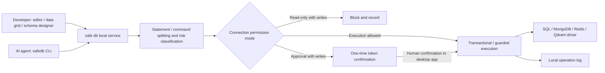

# safe db — a safe database tool for AI agents

[简体中文](README.md) | [English](README_EN.md)

> Let Codex, Claude Code, and other AI agents understand your database and run SQL—while you keep control of permissions, approvals, and audit history.

> [!IMPORTANT]
> **safe db is free forever. Every feature is free to use, with no limits based on connections, queries, or agents.**

AI agents can already read code, modify projects, and run tests. Database access is still awkward: either hand credentials to the agent or become the human API between the agent and your data.

safe db offers a third option. It is both a full desktop database workspace and a local database gateway designed for AI agents. Agents can discover saved connections, inspect schemas, validate SQL, and execute queries through a structured CLI without receiving database passwords. Every operation still passes through safe db's permission, approval, and audit pipeline.

With one tool, you can:

- Browse databases, edit data, and design schemas yourself.
- Give agents stable JSON context for one table or many tables at once.
- Block writes with Read-only mode or require a human decision with Approval mode.
- Keep credentials, saved queries, and audit history on your machine.

## A free alternative to Navicat and TablePlus

If your daily work mainly involves connecting to databases, browsing objects, editing SQL, managing table data, and changing schemas, safe db can be a free alternative to traditional database tools such as Navicat and TablePlus.

safe db is not simply copying a traditional database client. It rethinks database access for the AI-agent era: it covers common developer workflows while allowing Codex, Claude Code, and other agents to inspect schemas, validate SQL, and run queries without receiving database passwords. High-risk operations can still require a human decision.

Rather than claiming every feature found in mature database clients, safe db currently focuses on three things:

- **Practical daily workflows**: Connection management, object browsing, SQL editing, table data management, schema design, and result export.
- **Direct agent access**: A stable JSON CLI, single and multi-table schema context, SQL execution, and approval waiting.
- **Boundaries for production work**: Read-only, Approval, and Full-access modes backed by local audit history.

If you depend on advanced data migration, complete backup and restore workflows, ER modeling, or support for many database engines, you may still want to keep an established specialist tool. safe db aims first to become the most natural and secure everyday database gateway for developers and AI agents.

## Let an agent understand your database in a few commands

```bash
safedb connection list
safedb database list --connection <connection-id>
safedb object list --connection <connection-id> --database <database>

safedb table describe --connection <connection-id> --database <database> \
  --table users --table orders

safedb sql run --connection <connection-id> --database <database> --stdin < query.sql
```

The CLI writes stable single-line JSON to stdout by default, so Codex, Claude Code, and any other shell-capable agent can call it directly. For terminal use, add `--human` for command-specific tables and summaries, or `--format pretty` for indented JSON. Agents reference connections already saved in safe db; database and SSH credentials are never exposed through the CLI.

## Why safe db?

Most database clients answer how a person can operate a database. safe db also answers how people and AI agents can safely share database access.

- **An agent-native CLI**: Discover connections, databases, objects, DDL, and single or multiple table schemas as machine-readable JSON.
- **Credentials stay out of prompts**: The CLI uses connections already stored by safe db and never returns database or SSH passwords.
- **One safety pipeline**: Desktop actions and agent requests share SQL classification, permission checks, approval, execution, and auditing.
- **Safer by default**: New connections use Read-only mode, and unknown statements are treated as high risk.
- **Humans keep the final say**: In Approval mode, agent writes must be confirmed in the desktop app.
- **Local first**: Connections, saved queries, and operation logs remain on your device without a cloud database proxy.

## Core features

### Feature overview

| Feature | Capabilities |
| --- | --- |
| AI Agent CLI | Connection discovery, object browsing, single/multi-table schemas, DDL, SQL validation and execution, approval waiting |
| Machine-readable protocol | Stable JSON output, local socket transport, explicit statuses and error codes |
| Database connections | MySQL, PostgreSQL, SQLite, SQL Server, MongoDB, Redis, and Qdrant connections with connection testing |
| SSH tunnels | Jump hosts for every TCP database connection, with password and private-key authentication |
| Object browser | Browse databases, schemas, tables, views, functions, and stored procedures |
| SQL editor | Dialect-aware completion, keyboard execution, multiple tabs, and saved queries |
| Data management | Pagination, sorting, combined filters, and row insertion, editing, and deletion |
| Schema design | Inspect columns, indexes, and DDL; visually create and alter tables |
| Safety controls | Read-only, Approval, and Full access modes with high-risk SQL interception |
| Operation logs | Record successful, failed, blocked, and cancelled database operations |
| Data export | Export query results and table data as CSV / JSON |
| Multiple languages | Switch the interface language to match your preferences |
| Workspace experience | Multiple windows and resizable panels |

### Supported operating systems

safe db uses Electron and Node.js. The desktop app and Agent CLI support mainstream desktop operating systems:

| Operating system | Status | Notes |
| --- | --- | --- |
| macOS | ✅ Supported | Apple Silicon and Intel; credentials are protected by the system Keychain |
| Windows | ✅ Supported | Windows 10 / 11; the local agent service uses a Named Pipe |
| Linux | ✅ Supported | Ubuntu, Debian, Fedora, and similar desktop distributions; credential storage requires an available keyring / Secret Service |

The repository currently provides source-based development and build workflows. Run `npm run rebuild` after installing dependencies to rebuild SQLite for the current Electron runtime.

### Supported databases

| Database | Objects and schemas | Query execution | SSH tunnel | Agent CLI |
| --- | --- | --- | --- | --- |
| MySQL | ✅ | ✅ | ✅ | ✅ |
| PostgreSQL | ✅ | ✅ | ✅ | ✅ |
| SQLite | ✅ | ✅ | Not needed | ✅ |
| SQL Server | ✅ | ✅ SQL | ✅ | ✅ |
| MongoDB | ✅ Collections / sampled schemas | ✅ native JSON commands | ✅ | ✅ |
| Redis | ✅ keys / data types | ✅ Redis CLI commands | ✅ | ✅ |
| Qdrant | ✅ collections / points / payload indexes | ✅ restricted REST JSON | ✅ | ✅ |

### Three connection permission modes

| Mode | Read operations | Write / DDL operations | Best for |
| --- | --- | --- | --- |
| Read-only | Execute directly | Block directly | Production troubleshooting, data verification, and demos |
| Approval | Execute directly | Execute after confirmation | Routine maintenance and careful data corrections |
| Full access | Execute directly | Execute directly | Local development and test databases |

Permission modes can also be locked to prevent casual changes while a connection is in use. Multi-statement SQL and native command batches are handled according to the highest-risk operation they contain. Operations that cannot be classified reliably are treated as writes and subject to stricter permissions.

### A database workspace for developers

- MySQL, PostgreSQL, SQLite, SQL Server, MongoDB, Redis, and Qdrant connections with connection testing
- SSH jump hosts for every TCP database connection, with password and private-key authentication
- Browse databases, schemas, tables, views, functions, and stored procedures
- CodeMirror SQL editor, dialect-aware completion, and `Cmd/Ctrl + Enter` execution
- Save and organize queries by connection or database, with sanitized import and export across devices
- Paginate, sort, and combine filters for table data; insert, edit, and delete rows
- Automatically fall back to read-only browsing for tables without a primary key to avoid updating an ambiguous row
- Inspect table schemas, columns, indexes, DDL, and function definitions; visually create and alter tables
- Export query results or table data as CSV / JSON
- Multiple interface languages, tabs, windows, and resizable panels

### MongoDB, Redis, and Qdrant native commands

The MongoDB query editor accepts one JSON database command, or a JSON array of command objects:

```json
{"find":"users","filter":{"active":true},"limit":100}
```

The Redis query editor accepts Redis CLI syntax, one command per line, including quoted arguments:

```text
GET "user:1"
HGETALL "profile:1"
```

MongoDB collections and Redis keys can be browsed from the object tree and edited directly in the data grid, including insert, update, delete, and bulk import. MongoDB also supports collection create/copy/clear/drop and index management. Redis supports key create/copy/drop across its data types, while Stream entries expose insert and delete only. Redis cannot preserve a key with no data, so the capability model does not pretend that “clear while preserving the key” exists. Native command editors remain available as advanced entry points and still pass through the Read-only / Approval / Full access pipeline.

The Qdrant query editor accepts restricted REST JSON and only allows safely classified API paths on the current connection. For example:

```json
{
  "method": "POST",
  "path": "/collections/documents/points/query",
  "body": { "query": [0.1, 0.2], "limit": 10, "with_payload": true }
}
```

Qdrant collections appear directly below the connection. Points use cursor pagination, and vectors are omitted by default. The data view supports inserting, editing, and bulk-deleting points; collection actions include JSON/CSV import, clear, delete, definition inspection, and payload-index management. REST JSON may use a restricted `query` object for `wait`, `ordering`, `timeout`, and `consistency`.

All seven database drivers now use the shared capability model and structured-operation protocol. The renderer submits intent while identifier quoting, parameter binding, MongoDB BSON conversion, Redis command construction, and Qdrant REST construction stay in main-process drivers. MySQL, PostgreSQL, SQLite, and SQL Server provide parameterized CRUD plus table create/alter/copy/clear/drop and index management; MongoDB, Redis, and Qdrant advertise their real domain capabilities. Every operation reports its actual `transaction`, `single-request`, or `best-effort` atomicity without implying unavailable cross-request rollback.

### Safe execution pipeline

SQL and native commands from both developers and AI agents pass through the same execution pipeline:



The classifier skips comments, strings, and quoted identifiers. It also recognizes easily misclassified cases such as data-modifying CTEs, `EXPLAIN ANALYZE`, `SELECT INTO`, and multi-statement SQL. Multi-statement writes and DDL are executed inside a transaction.

## Quick start

Node.js 20 LTS and npm 10+ are recommended.

```bash
git clone <your-repository-url>
cd safe-db
npm ci
npm run rebuild
npm run dev
```

`npm run rebuild` rebuilds the native `better-sqlite3` module for the current Electron version. After the first launch:

In macOS development mode, `npm run dev` automatically prepares an Electron runtime named `safe db` under `node_modules/.cache/`, so the product name is also displayed correctly in the system menu bar. This cache is not committed to version control.

1. Click “New” in the sidebar and choose MySQL, PostgreSQL, SQLite, SQL Server, MongoDB, Redis, or Qdrant.
2. Enter the connection details and choose a permission mode. Start with Read-only for production databases.
3. Test and save the connection, then double-click it to browse database objects.
4. Double-click a table to view its data, or right-click a connection to create a SQL query.
5. When writes are needed, switch to Approval mode to retain confirmation protection.

To use the Agent CLI, create a production build once:

```bash
npm run build
node scripts/safedb.mjs connection list
```

When installed as an npm binary, use the `safedb` command directly.

## Common commands

```bash
# Start the development environment with hot reload for main, preload, and renderer
npm run dev

# TypeScript and Vue type checking
npm run typecheck

# SQL risk-classifier tests
npm run test:classify

# MongoDB / Redis / Qdrant native-command classifier tests
npm run test:native
npm run test:qdrant
npm run test:operations
npm run test:drivers

# AI Agent CLI service tests
npm run test:agent

# AI Agent CLI output and localized-help tests
npm run test:cli

# Create a production build in out/
npm run build

# Preview the production build
npm run start
```

## AI Agent CLI reference

The CLI only uses connections saved in safe db. SQL is read from stdin or a file so it does not appear in process arguments or shell history:

```bash
# Discover connections and database objects
safedb connection list
safedb database list --connection <connection-id-or-exact-name>
safedb object list --connection <connection-id> --database <database>

# Describe one or multiple tables; repeat --table for up to 20 distinct tables
safedb table describe --connection <connection-id> --database <database> --schema <schema> \
  --table users --table orders

# Validate or execute SQL
safedb sql check --connection <connection-id> --database <database> --file query.sql
safedb sql run --connection <connection-id> --database <database> --stdin < query.sql

# Approval-mode writes return a requestId handled by the desktop app
safedb request get <request-id>
safedb request wait <request-id> --timeout 60

# Human-readable tables/summaries, or indented JSON
safedb connection list --human
safedb table describe --connection <connection-id> --table users --format human
safedb connection list --format pretty

# Select the help language; SAFE_DB_LANG is also supported
safedb --help --lang zh-CN
SAFE_DB_LANG=ja-JP safedb table describe --help
```

The default `--format json` always writes one JSON object to stdout for compatibility with agents and scripts. `--format pretty` writes the complete indented JSON response. `--format human` (or `--human`) renders command-specific tables, query results, DDL, and approval summaries. In human mode errors go to stderr while other results go to stdout; exit codes remain the same in every mode. Read-only connections block writes, Approval connections open a desktop confirmation window, and Full-access connections retain their configured behavior. If the local service is not running, the CLI attempts to start the built app in headless mode.

CLI help is available in `zh-CN`, `zh-TW`, `en-US`, `ja-JP`, `ko-KR`, `de-DE`, `fr-FR`, `es-ES`, `pt-BR`, and `ru-RU`. The selection order is `--lang`, `SAFE_DB_LANG`, then the system locale; unmatched locales fall back to Simplified Chinese. `--lang` only affects `help` and `--help` text and does not change JSON protocol fields.

The repository's `scripts/` directory also contains checks covering the UI, database drivers, native-command classification, permission approval, read-only bypass attempts, and the schema designer. Some scripts require local database test instances and use Electron's CDP port in development mode.

Before submitting code, run at least:

```bash
npm run typecheck
npm run test:classify
npm run test:native
npm run test:qdrant
npm run test:operations
npm run test:agent
npm run test:cli
npm run build
```

## Technology stack

| Layer | Technology |
| --- | --- |
| Desktop runtime | Electron 33, electron-vite |
| Frontend | Vue 3, TypeScript, Pinia, Vue Router |
| UI / editor | Naive UI, CodeMirror 6 |
| Databases | mysql2, pg, better-sqlite3, mssql, mongodb, redis, @qdrant/js-client-rest |
| Networking | ssh2 |
| Local storage | JSON, SQLite, Electron safeStorage |

## Project structure

```text
safe-db/
├── src/
│   ├── main/
│   │   ├── agent/        # Agent CLI protocol, local service, and approval-request lifecycle
│   │   ├── core/         # SQL splitting, risk classification, permission decisions, unified executor
│   │   ├── drivers/      # SQL Server / MySQL / PostgreSQL / SQLite / MongoDB / Redis / Qdrant drivers
│   │   ├── ssh/          # SSH tunnel lifecycle
│   │   ├── store/        # Connections, saved queries, and operation logs
│   │   └── ipc.ts        # Main-process IPC entry point
│   ├── preload/          # APIs safely exposed to the renderer
│   ├── renderer/         # Vue workspace and components
│   └── shared/           # Type contracts shared by the main process and renderer
├── scripts/              # Classifier tests and end-to-end verification scripts
└── electron.vite.config.ts
```

## Data and security notes

- Connection settings are stored in Electron's `userData/connections.json`.
- Database passwords, SSH passwords, and private-key passphrases are encrypted with Electron `safeStorage`. If system encryption is unavailable, safe db refuses to save them instead of falling back to plaintext.
- Saved queries are stored in `userData/queries.json`, and operation logs are stored in `userData/audit.db`.
- Exported connection packages never contain database passwords, SSH passwords, or private-key passphrases. These values must be entered again after import.
- The renderer enables `contextIsolation` and disables `nodeIntegration`. It accesses main-process capabilities only through the typed preload API.
- Data-grid filter values use parameter binding, while column and table names are quoted according to each database dialect.

> [!IMPORTANT]
> safe db's permission modes are client-side safeguards against accidental operations, not a replacement for the database's own permission system. Production environments should still use least-privilege accounts, database auditing, backups, and change-approval processes. Client-side rules also cannot restrict operations initiated through other tools or connections.

## Contributing

This project offers several clear, self-contained areas for contribution:

- **Add a database driver**: Implement the `DbDriver` interface in `src/main/drivers/base.ts` and register it with the driver manager.
- **Harden the SQL classifier**: Add rules to `src/main/core/sqlClassify.ts` and include tests for adversarial inputs.
- **Extend the Agent protocol**: Improve machine-readable schema context, result limits, error codes, and additional agent tools.
- **Improve database dialects**: Enhance table DDL, type mappings, function definitions, or SQL completion.
- **Improve the workspace**: Refine the data grid, keyboard shortcuts, accessibility, themes, and large-data handling.
- **Add a language**: Extend translations in `src/renderer/src/locales/` and keep translation keys aligned.

When submitting changes, keep all database operations going through the unified `Executor` wherever possible, and include failing test cases for changes involving permission boundaries. The most important characteristic of a safety tool is not that it appears to block dangerous actions, but that its rules are readable, its behavior is testable, and it fails safely.

---

If you use Codex, Claude Code, or your own agent to build software, let safe db become its safe gateway to your databases. The project is free forever, and feedback and contributions are always welcome.
